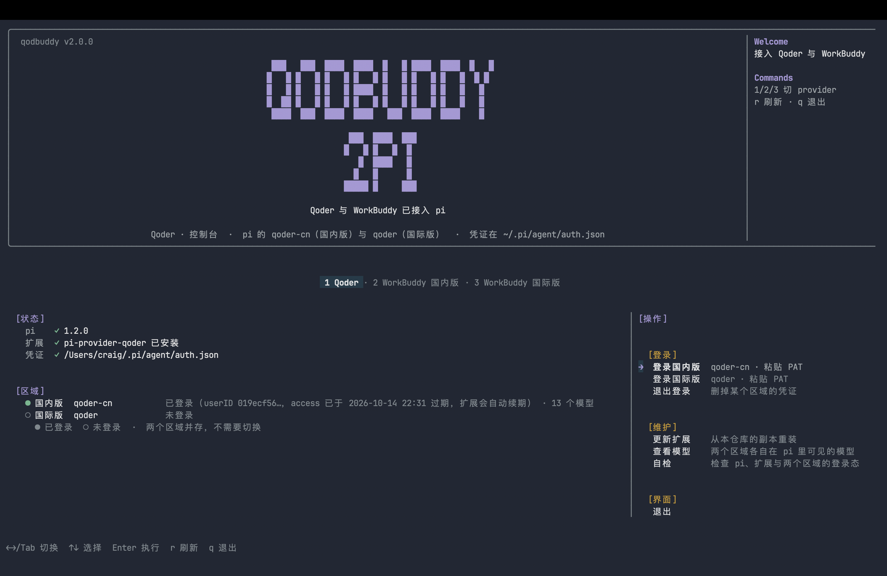

<p align="right">  
   <strong>简</strong> | <a href="./README.en.md">EN</a>  
</p>

<div align="center">

# QodBuddy2Pi

</div>

<p align="center">  
    <em>把 Qoder 与 WorkBuddy 的订阅额度接进 pi coding agent。</em>  
</p>

<p align="center">  
    <a href="https://github.com/CraigKettleman/qoder2pi/releases"></a>  
    <a href="https://www.npmjs.com/package/qodbuddy2pi"></a>  
    <a href="https://github.com/CraigKettleman/qoder2pi/releases"></a>  
      
      
      
    <a href="LICENSE"></a>  
</p>

<p align="center">  
      
</p>

<p align="center">  
    <sub>总控界面：顶部 banner、页签行、左栏状态与分区、右栏操作菜单、底部状态栏</sub>  
</p>

## Qodbuddy2pi 是什么?

一条命令把 Qoder 与 WorkBuddy 接成 pi 的 provider。装完之后 `qodbuddy2pi` 是一个总控界面，三个 provider 用页签切换。

## 支持的 provider

四个 provider 互相独立，可以只装其中一个：

|               | provider           | 端点               | 凭证                                 | 登录    |
| ------------- | ------------------ | ---------------- | ---------------------------------- | ----- |
| Qoder 国内版     | `qoder-cn`         | 直连 Qoder 网关      | pi 的 `auth.json`                   | PAT   |
| Qoder 国际版     | `qoder`            | 直连 Qoder 网关      | pi 的 `auth.json`                   | PAT   |
| WorkBuddy 国内版 | `workbuddy`        | `127.0.0.1:8787` | `~/.codebuddy-session.json`        | 浏览器登录 |
| WorkBuddy 国际版 | `workbuddy-global` | `127.0.0.1:8788` | `~/.codebuddy-global-session.json` | 浏览器登录 |

装完之后在 pi 里用 `/model` 选择模型，或者直接指定：

```bash
pi --provider qoder-cn        --model deepseek-v4.1-flash
pi --provider qoder           --model <模型ID>
pi --provider workbuddy       --model deepseek-v4.1-flash
pi --provider workbuddy-global --model <模型ID>
```

## 为什么选择Qodbuddy2pi？

Qoder 与 WorkBuddy 的免费账户每日可领积分，可以使用相当不错的低倍率模型额度，但只能在各自客户端里用，而客户端预装了繁重的提示词，**无法更改**，会额外消耗积分并影响模型表现。

把额度接到 pi 里需要自己拼 provider 配置、写启动命令、盯 token 过期。token 静默失效时 ，所有请求 401，服务看起来却还是「正常」的，排查成本高于转发本身。

### 优势

- 一个脚本装齐所有依赖
- 简洁的 TUI，状态、账号、登录态、日志在一屏里
- 一次登录，凭证长期自动刷新
- 账号切换一条命令

## 安装

**macOS / Linux**

```bash
curl -fsSL https://raw.githubusercontent.com/CraigKettleman/qoder2pi/main/install.sh | sh
```

**Windows**

```powershell
irm https://raw.githubusercontent.com/CraigKettleman/qoder2pi/main/install.ps1 | iex
```

**npm / pnpm / bun**

```bash
npm i -g --ignore-scripts qodbuddy2pi && qodbuddy2pi install
pnpm add -g --ignore-scripts qodbuddy2pi && qodbuddy2pi install
bun add -g --ignore-scripts qodbuddy2pi && qodbuddy2pi install
# 或 npx --yes qodbuddy2pi install
```

`--ignore-scripts` 是刻意的：包本身不该在安装时改动你的 pi 配置。接入是显式的  
`qodbuddy2pi install`，你在眼前看到它要装什么。

**Release 下载压缩包**

到 [Releases](https://github.com/CraigKettleman/qoder2pi/releases) 下载 `qodbuddy2pi.tar.gz` （Unix）或 `qodbuddy2pi.zip`（Windows，系统自带解压），解开后跑 `./start.sh`（Windows 是`start.cmd`）。想核对完整性？Release 里带有`SHA256SUMS`：

```bash
shasum -a 256 -c SHA256SUMS        # macOS / Linux
Get-FileHash qodbuddy2pi.zip       # Windows（与文件里的值对照）
```

**源码安装**

```bash
git clone https://github.com/CraigKettleman/qoder2pi && cd qoder2pi
./install.sh                     # macOS / Linux
powershell -ExecutionPolicy Bypass -File install.ps1   # Windows
```

不带参数时会先探测本机现状（已登录哪个区域、哪个反代在跑），列出结果逐项确认，回车采纳默认值。参数所有入口通用：

```bash
--all                 # 全装四个 provider
--only qoder-cn       # 只装指定的（可逗号分隔，也可重复 --only）
--no-service          # 只装接入，不注册常驻服务
--force-reinstall     # 即使已接入也重装一遍
--non-interactive     # 不提问，按探测结果装
--help
```

Windows 上对应 `-All`、`-Only`、`-NoService`、`-ForceReinstall`、`-NonInteractive`。

### 登录

Qoder 需要一个 PAT，从这里创建：

- 国内版 <https://qoder.com.cn/account/integrations>
- 国际版 <https://qoder.com/account/integrations>

得到 `pt-` 开头的令牌后交给安装器，或事后运行 `qoder2pi login cn pt-xxxxxx`。也可以运行  
`pi` 后输入 `/login qoder-cn`（国内版）或 `/login qoder`（国际版）手动登录。

WorkBuddy 走浏览器登录，最多等 5 分钟。两个区域路径相同：桌面端落盘的凭证不通用  
（国际版是加密对象，导入出来每个请求都 401），原因见 [排错](docs/troubleshooting.md)。

## 功能

### 总控界面

一条命令打开全屏总控，一页一个 provider，用数字键或 `←→`/`Tab` 切换：

```
 1 Qoder · 2 WorkBuddy 国内版 · 3 WorkBuddy 国际版
```

按键：`↑↓`/`jk` 移动，`Enter` 执行，`r` 刷新，`q`/`Esc` 退出；滚轮可移动选中项或在文本页滚动。日志与自检结果进独立的可滚动文本页。

### 工作机制

workbuddy2pi：

```
pi（provider workbuddy，        baseUrl = http://127.0.0.1:8787/v1）
pi（provider workbuddy-global， baseUrl = http://127.0.0.1:8788/v1）
  ↓
两个独立的 codebuddy_proxy 实例（PyPI 包 workbuddy2api 提供）
  ↓  协议转换 + token 自动刷新
copilot.tencent.com（国内版） / www.workbuddy.ai（国际版）
```

Qoder2pi：扩展 `pi-provider-qoder` 直接跟 Qoder 网关通信，凭证落在 pi 自己的`auth.json`。所以两个产品的形态并不对称——Qoder 管的是两个区域的登录状态，WorkBuddy 有端口、常驻服务、多账号。

端点必须显式写成 `www.workbuddy.ai`：反代 2.0.6 的国际版默认端点是 `www.codebuddy.ai`，而账号自身的 domain 与登录接口都在 `workbuddy.ai` 下。两个区域的 session 文件被反代按`backend` 元数据隔离，拿国内版的文件去起国际版实例会被直接拒绝。

### 服务与凭证

- **常驻服务**：WorkBuddy 反代由常驻服务拉起，开机/登录自动运行，崩溃自动重启。macOS 用launchd、Linux 用 systemd --user、Windows 用计划任务
- **凭证有效性直读**：账号后面显示 access_token 的剩余天数与到期时间，纯文本 `status`里 access_token 与 refresh_token 两项都列出
- **幂等安装**：反复运行安装器不会破坏已有凭证，只替换与仓库版本不一致的文件

### 多区域与多账号

Qoder 的两个区域并存，不需要二选一。WorkBuddy 的国际版是独立实例：端口、凭证、账号、日志各用各的。

|         | 国内版                          | 国际版                                 |
| ------- | ---------------------------- | ----------------------------------- |
| 在总控里    | 第 2 页                        | 第 3 页                               |
| 端点      | `http://127.0.0.1:8787/v1`   | `http://127.0.0.1:8788/v1`          |
| 上游      | `copilot.tencent.com`        | `www.workbuddy.ai`                  |
| 生效凭证    | `~/.codebuddy-session.json`  | `~/.codebuddy-global-session.json`  |
| 账号 slot | `~/.workbuddy2api/sessions/` | `~/.workbuddy2api/sessions-global/` |
| 日志      | `~/.workbuddy2api/`          | `~/.workbuddy2api/global/`          |
| 常驻服务    | `workbuddy2api`              | `workbuddy2api-global`              |

**多账号**只存在于 WorkBuddy。每个账号是一份 session 文件，放在当前区域的 slot 目录下。切换时先把当前生效文件里最新的凭证存回它所属的 slot，再写入目标 slot 并重启服务，所以来回切换不会丢 token；归属判定靠文件里的 `account.uid`，切换过程中被中断也不会串写凭证。`account remove` 不真删文件，而是改名留档，删错了改回名字即可恢复。

**同一区域内的反代同一时刻只服务一个账号**（启动时把 session 读进内存，无法热切换）。要让多个账号同时在线需要多开实例，本仓库只在国内版与国际版之间做了这种拆分。

### 命令行运维

兼容 cli 运维。

```bash
qodbuddy2pi              # 总控界面：1/2/3 或 Tab 切 provider
qodbuddy2pi --check      # 只看环境检查（纯文本，适合脚本）
qodbuddy2pi probe        # 以 JSON 报出已接入哪些 provider
qodbuddy2pi install      # 接入 / 重装 provider（跑包内自带的安装器）
qodbuddy                 # 总控（第一页）
qoder2pi                 # Qoder 页
workbuddy2pi             # WorkBuddy 国内版页
```

`qoder2pi` 与 `workbuddy2pi` 还各自带子命令，纯文本输出，适合脚本：

```bash
qoder2pi status                 # pi、扩展与两个区域的登录状态
qoder2pi login cn pt-xxxxxx     # 用 PAT 登录国内版
qoder2pi models                 # 列出两个区域在 pi 里可见的模型
qoder2pi doctor                 # 自检

workbuddy2pi status             # 服务、端点、凭证、账号
workbuddy2pi account b          # 切到账号 b
workbuddy2pi account renew      # 续期当前账号的凭证
workbuddy2pi logs 100           # 反代日志尾部
workbuddy2pi restart            # 重启服务
workbuddy2pi global <命令>       # 上面这些作用于国际版实例
workbuddy2pi doctor             # 自检
```

完整命令与界面按键见 [运维命令](docs/operations.md)。

### 安装内容

| 组件                    | 位置                         | 作用                                                |
| --------------------- | -------------------------- | ------------------------------------------------- |
| `assets/qodbuddy2pi`  | `~/.local/bin/`            | 总控界面                                              |
| `assets/qoder2pi`     | `~/.local/bin/`            | Qoder 运维命令 + 总控的 Qoder 页                          |
| `assets/workbuddy2pi` | `~/.local/bin/`            | WorkBuddy 运维命令 + 总控的两个 WorkBuddy 页                |
| `assets/qodbuddy`     | `~/.local/bin/`            | 别名                                                |
| `assets/tui.js`       | `~/.local/bin/`            | 界面本体与共享工具（四个命令共用）                                 |
| `assets/workbuddy.ts` | `~/.pi/agent/extensions/`  | 注册 pi 的 `workbuddy` / `workbuddy-global` provider |
| `pi-provider-qoder`   | 本仓库 `assets/vendor/`       | 注册 pi 的 `qoder-cn` / `qoder` provider             |
| `workbuddy2api-*.whl` | `~/.workbuddy2api/vendor/` | 反代实现本体，由常驻服务加载                                    |

两个 provider 的实现本体与扩展副本都固定在本仓库，安装脚本不会从别的仓库拉取（Node、pi、uv、Python 传递依赖是宿主程序与通用基础库，物理上放不进仓库）。版本、官方校验值、许可与更新方法见 [assets/vendor/README.md](assets/vendor/README.md)。

### 注意事项

- **反代刷新 token 后不再主动刷新**：服务端只返回相对的 `expiresIn`，反代会因此丢掉绝对的`expiresAt`，之后把凭证当成永不过期。建档与续期时一律补算绝对时间，`account renew`可以把时间写回 slot
- 添加完账号后如在 pi 运行/model 无法使用模型，可在/scoped-models 查看是否被隐藏，具体使用方式不在这里赘述。
- **pi 会丢弃没有认证方式的 provider**：`auth.json` 里两个 WorkBuddy provider 各需一个占位key，由 `ensure-auth-key` 一并补齐
- **不从桌面端落盘的凭证建档**：国际版是加密对象，反代不会解密，导入出来每个请求都 401；两个区域统一走浏览器登录
- **国际版模型表**：反代自带的国际版模型表里的 id 在服务端并不存在，改读客户端落盘的产品配置
- **launchd 的 `bootout` 是异步的**：运维命令会等标签真正消失后再注册，避免


  `Bootstrap failed: 5: Input/output error`

细节见 [排错](docs/troubleshooting.md)。

## 文档

|                               |                           |
| ----------------------------- | ------------------------- |
| [安装与接入](docs/install.md)      | 完整的安装流程、两个平台各自的步骤、登录凭证怎么拿 |
| [运维命令](docs/operations.md)    | 所有命令、界面按键、两个区域的分工、常驻服务    |
| [账号与凭证](docs/accounts.md)     | 多账号机制、凭证有效期怎么读、国际版能用哪些模型  |
| [排错](docs/troubleshooting.md) | 常见问题与已规避的坑                |
| [CONTEXT.md](CONTEXT.md)      | 本项目的术语表                   |
| [docs/adr/](docs/adr/)        | 设计决策记录                    |

## 开发

```bash
./dev.sh          # 开发模式入口：直接用仓库里的代码跑总控，不安装
npm test          # 纯函数测试（node:test，零依赖）
```

改完 `assets/tui.js` 用 `./dev.sh` 就能立刻看到效果。测试覆盖纯函数、渲染宽度与两份安装
脚本的一致性，渲染行为由 `python3 test/pty-render.py` 在真实 PTY 里验证。

打 `v*` tag 会触发 `.github/workflows/release.yml`：先跑测试，再发 npm 包，最后用
`make-release.sh --all` 生成平台无关的压缩包并附到 GitHub Release，同时产出
`SHA256SUMS`。压缩包内容来自 `npm pack`，与 npm 上发布的包是同一份文件集合。

改动前先读 [CONTEXT.md](CONTEXT.md)（术语表）与 [docs/adr/](docs/adr/)（设计决策），
它们说明了为什么代码是这个形状。

## Star History

<a href="https://star-history.com/#CraigKettleman/qoder2pi&Date">
 <picture>
   <source media="(prefers-color-scheme: dark)" srcset="https://api.star-history.com/svg?repos=CraigKettleman/qoder2pi&type=Date&theme=dark" />
   <source media="(prefers-color-scheme: light)" srcset="https://api.star-history.com/svg?repos=CraigKettleman/qoder2pi&type=Date" />
   
 </picture>
</a>

## 贡献

Issue 与 PR 都欢迎。改动前先读 [CONTEXT.md](CONTEXT.md) 与 [docs/adr/](docs/adr/)，
新增的设计决策按 `docs/adr/NNNN-<短横线标题>.md` 的格式补一份记录。

## 许可

MIT，见 [LICENSE](LICENSE)。仓库里两份第三方制品各遵自己的许可，见该文件末尾。
